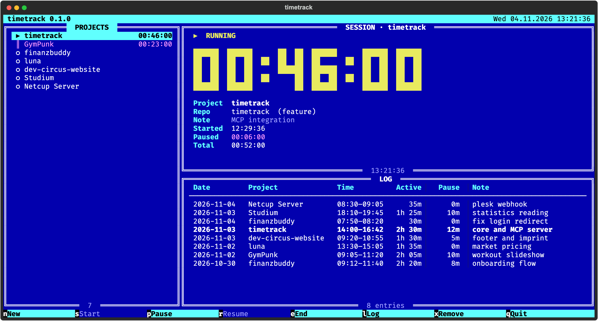

# timetrack

Project-based time tracking for the terminal — and for Claude.



One shared core (state + log) drives three frontends:

- **TUI** in Norton Commander style — `timetrack`
- **CLI** — `timetrack start | pause | resume | stop | status | log | summary | projects | migrate`
- **MCP server** for Claude — `timetrack-mcp`

The project is detected from the Git repo of the working directory, or from the folder name if there is none. Sessions survive closing the terminal, and the TUI shows live what was started from the CLI or by Claude.

## Features

- **Per-project sessions** — starting one project pauses the running one automatically
- **Active vs. paused time** — logged separately, `duration_min` is active time only
- **Retroactive end** — forgot to stop? `timetrack stop --at 17:30`
- **Works without Git** — outside a repo the folder name is the project; for Home or anything else give a name: `timetrack start -p "Reading"`
- **Persistent state** — sessions live in `state.json` (file lock, atomic writes), not in the terminal
- **Local only** — everything stays on your machine, the log is a plain CSV
- **Claude integration** — an MCP server that starts, pauses and stops the clock per Git repo, on request

## Install

Requires macOS or Linux and [uv](https://docs.astral.sh/uv/).

```bash
git clone https://github.com/dev-circus/timetrack.git
cd timetrack
uv tool install .          # puts timetrack and timetrack-mcp on your PATH
```

After code changes: `uv tool install --reinstall .`

## TUI

| Key | Action |
|-----|--------|
| `↑` `↓` | Select project |
| `n` | New project (defaults to the current Git repo) |
| `s` / `↵` | Start (`↵` toggles start / pause / resume) |
| `p` · `r` | Pause · Resume |
| `e` | End session, with an optional note |
| `l` | Log manager (`↑↓` move, `d` delete, `q` back) |
| `x` | Remove project from the list (log stays) |
| `q` | Quit — running sessions keep running |

## Claude (MCP)

```bash
claude mcp add --scope user timetrack -- "$(command -v timetrack-mcp)"
```

Tools: `status`, `start`, `pause`, `resume`, `stop` (with `note` and retroactive `at`), `log`, `summary`, `projects`.

Claude starts and stops the clock only when you ask it to. It passes the session's working directory as `cwd`, so the project follows the repo (or folder) you are working in. Without a usable folder (Home, `/`, a chat), Claude asks you for a project name and passes it as `project`; new projects are created on the first `start`.

## Data

Default location is `~/.timetrack/` (override with `TIMETRACK_HOME`).

| File | Content |
|------|---------|
| `state.json` | Projects and open sessions |
| `log.csv` | `date,project,repo,branch,start,end,duration_min,note,paused_min` |

Coming from v3 (single file, log in `~/timetrack/log.csv`)? Run `timetrack migrate --dry-run`, then `timetrack migrate`. It merges the old log with a backup and leaves the source untouched. Entries from v3 have no pause information and contain gross time.

## Development

```bash
uv sync
uv run pytest
```

## License

MIT — © 2026 >devcircus_ · [www.dev-circus.com](https://www.dev-circus.com) · by Patrick B. Stang
